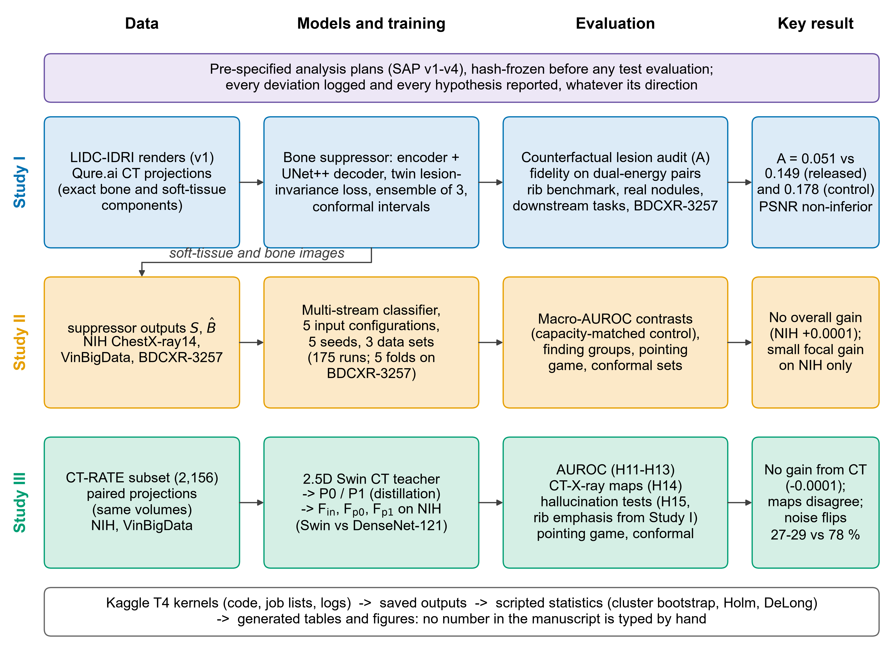
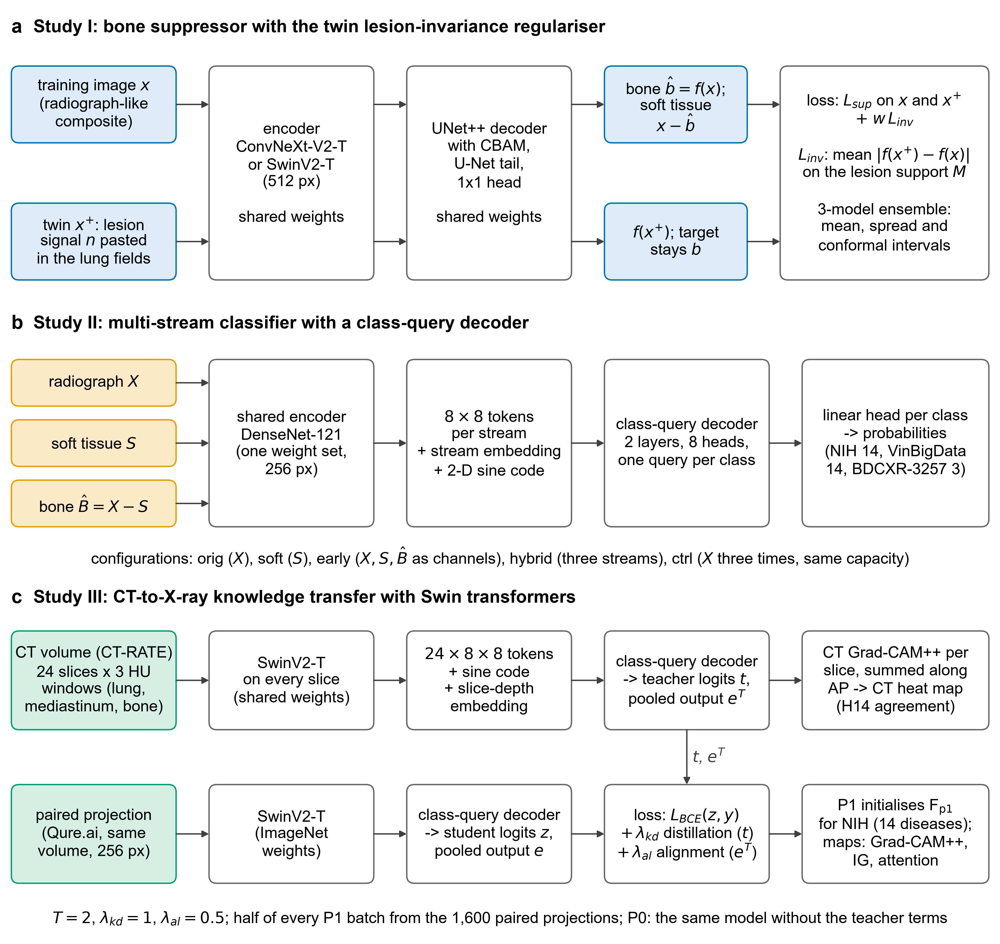

# Explainable and hallucination-aware cross-modality learning from chest CT for X-ray disease classification

**Lesion-faithful bone suppression and Swin transformer knowledge transfer**

[](https://github.com/HTanvir0011/Thesis-full-project/actions/workflows/tests.yml)
[](LICENSE)


Code, pre-specified analysis plans, Kaggle kernels, saved results, manuscript and thesis of Tanvir Hossin (Daffodil International
University, Dhaka, Bangladesh).

**[Manuscript](manuscripts/manuscript.pdf)** · **[Supplementary material](manuscripts/supplementary.pdf)** ·
**[Thesis](manuscripts/thesis.pdf)** · **[Analysis plans](protocol/)** · **[How to cite](#citation)**

> The manuscript is in preparation for journal submission and has not been peer reviewed. This is research code, not a medical device.



## Overview

CT can supervise models of chest radiographs, but such models may erase lesions, report findings that are not there, or explain their
decisions poorly, and accuracy metrics miss all three. Three studies, each run under an analysis plan that was hash-frozen before testing,
ask what CT-supervised models erase, invent and highlight:

| Study | Question | Main result |
|---|---|---|
| I | Do CT-supervised bone suppressors erase lesions, and does a twin lesion-invariance regulariser prevent it? | On VinDr-RibCXR the twin ensemble absorbed 0.051 of an added lesion, a released CT-supervised model 0.149 and a matched control 0.178, at non-inferior bone-region PSNR. |
| II | Do classifiers gain from bone-suppressed inputs (175 runs, three data sets, capacity-matched controls)? | As separate streams, suppressed inputs did not raise macro-AUROC on any data set (NIH +0.0001 [-0.0022, 0.0024]); as extra channels they gave small gains (NIH up to +0.006). |
| III | Does a 2.5D Swin CT teacher (CT-RATE) improve Swin X-ray classifiers through distillation on paired projections? | No gain on NIH (-0.0001 [-0.0016, 0.0014]), and CT and X-ray Grad-CAM++ maps disagreed. Swin Grad-CAM++ located expert boxes less than half as often as DenseNet-121, yet noise flipped far fewer finding-free images (27-29 % against 78 %). |

Models of equal fidelity or accuracy differed widely in what they erase, invent and highlight, which is why these properties should be
audited. The intervals are 95 % cluster-bootstrap intervals. The manuscript gives the full results, failed hypotheses included.



## Repository structure

```
.
├── manuscripts/     compiled PDFs: manuscript, supplementary material, thesis
├── submission/      journal manuscript as an Overleaf project (main.tex, supplementary.tex, sections, tables, figures, refs.bib)
├── thesis/          thesis sources (LaTeX; shares sections, tables and figures with paper/)
├── paper/           LaTeX sections shared with the thesis, generated tables and figures, bibliography
├── protocol/        analysis plans, designs, run plans, hash freezes, decision and deviation logs (see protocol/README.md)
├── s4/              research package: CT physics and rendering, suppressor, lesion audit, classifiers, cross-modal models, statistics
├── tools/           statistics, tables, figures, freeze check, packaging of the manuscript and of this snapshot
├── ops/             launchers that write and push the Kaggle kernels; job queue
├── kernels/         the exact code and metadata of every Kaggle kernel that was run
├── outputs/         what the kernels returned, as text: result files, run summaries, training logs
├── results/         collected results, statistics (final_*stats*.json) and generated figures
├── splits/          LIDC-IDRI patient split
├── release/, site/  model card of the bone suppressor and a demo app (neither is published yet)
└── tests/           unit tests (CPU, synthetic data)
```

Main entry points of `s4/`:

| Module | Purpose |
|---|---|
| `xray.py`, `ct.py`, `seg.py`, `nodule.py`, `render.py`, `compose.py` | CT to radiograph physics (NIST attenuation, SpekPy spectra), lesion insertion and the sample composer (X' = S' + B' exactly) |
| `model.py`, `losses.py`, `train.py` | bone suppressor (Swin-V2 or ConvNeXt-V2 encoder, nested UNet++ decoder, CBAM) and its training arms, including the counterfactual twins of the lesion-invariance regulariser |
| `audit_real.py`, `audit_qp.py`, `eval_real.py`, `eval_synth.py` | counterfactual lesion audit on real radiographs and on projections; fidelity on real dual-energy pairs and on synthetic truth |
| `cls_hybrid.py`, `uq_conformal.py`, `xai_multistream.py` | Study II: multi-stream classifier, conformal uncertainty, attribution and pointing game |
| `ct_prep.py`, `xm.py`, `xm_xai.py`, `xm_halluc.py` | Study III: CT subset, Swin CT teacher and distillation, cross-modal heat maps, hallucination tests |
| `stats.py`, `delong.py`, `froc.py` | cluster bootstrap, paired DeLong test, FROC |

## Getting started

```bash
git clone https://github.com/HTanvir0011/Thesis-full-project.git
cd Thesis-full-project
pip install -r requirements.txt     # Python 3.14; training ran on Kaggle's own image (kernels/)
python -m pytest                    # 174 tests with synthetic data; 2 need a CUDA GPU and 2 the unpublished CT-RATE lists, else they skip
python tools/verify_freeze.py       # every analysis plan and design is byte-identical to its frozen version
```

## Reproducing the results

**From this repository alone**

| What | Command |
|---|---|
| Check the plans against their freezes | `python tools/verify_freeze.py` |
| Workflow and architecture diagrams | `python tools/fig_framework.py` |
| Manuscript PDF | compile `submission/main.tex` and `submission/supplementary.tex` (pdfLaTeX + BibTeX), or upload `submission/` to Overleaf |
| Manuscript as an Overleaf zip | `python tools/pack_overleaf.py` |
| Thesis PDF | compile `thesis/main.tex` (pdfLaTeX + BibTeX) |

Every result in the manuscript comes from a saved statistics file: `results/final/stats_held.json` (Study I),
`results/final_hybrid_stats.json` (Study II), `results/final_xm_stats.json` (Study III) and the aggregate files in `results/`, which the
generated tables in `paper/tables/` print.

**With the data, the per-image predictions or the weights**

These scripts recompute the statistics, tables and figures. They read the per-image prediction and label arrays and, for some
figures, the images and model weights, none of which are in this repository (see below).

| Study | Statistics and tables | Figures |
|---|---|---|
| I | `python tools/final_stats.py`; `python tools/bdcxr_stats.py` (BDCXR-3257) | `python tools/paper_extras.py --audit-map`, `python tools/fig_pareto.py final`, `tools/fig_real_qualitative.py` |
| II | `python tools/hybrid_stats.py` | `python tools/generate_all_thesis_figures.py` |
| III | `python tools/xm_stats.py`, then `python tools/xm_tables.py` | `python tools/fig_v4.py` |

Without those inputs the scripts stop or write incomplete files over the saved ones; `git checkout -- results paper` restores them.
Training and evaluation ran in Kaggle kernels: `ops/launch_*.py` writes and pushes a kernel (it needs your own Kaggle accounts in
`config.yaml` and a token file, see `ops/kg.py`), and `kernels/` keeps every version that was run. Locked-set evaluations run with `tools/final_local.sh`.

## Pre-specified analysis plans

Each study was run under a statistical analysis plan written before the data it governs were evaluated and hash-frozen with the split files
and the code. The plans are pre-specified and hash-frozen but were not deposited in a public registry. Every later change is logged in
`protocol/DEVIATIONS.md`, and `python tools/verify_freeze.py` shows that every plan in `protocol/` is byte-identical to its frozen version.
[protocol/README.md](protocol/README.md) lists the plans, freeze dates and logs.

## Data

No image of any data set is redistributed here. Obtain each set from its provider under its own terms; the manuscript cites each one.

| Data set | Role | Licence or access (providers' pages, read on 3 November 2026) |
|---|---|---|
| LIDC-IDRI (TCIA) | renders of the first (v1) suppressor, lesion library, synthetic test CTs | CC BY 3.0; attribution with the data DOI |
| Qure.ai ct2xr-projections | Study I training source; Study III projection models | CC BY-NC-SA 4.0 |
| CT-RATE | source of the projections; Study III CT teacher (2,156 volumes) | CC BY-NC-SA 4.0, gated |
| SZCH-X-Rays | paired dual-energy evaluation (24 development, 51 held-out) | CC BY-NC 4.0 |
| VinDr-RibCXR | locked audit and rib benchmark (245 images) | licensed; local use, metrics only |
| JSRT | audit and nodule contrast | free after registration; no redistribution or commercial use |
| Node21 | nodule contrast, detection | CC BY-NC-ND 4.0 |
| TBX11K | detection | CC BY 4.0 (data) |
| VinBigData / VinDr-CXR | detection; classification; Study III zero-shot transfer | competition rules: non-commercial research use |
| NIH ChestX-ray14 | classification (Studies II and III) | unrestricted use with attribution (NIH Clinical Center) |
| BDCXR-3257 | external validation (pneumonia classification, audit) | CC BY 4.0 (figshare); used under the providers' data use agreement |

## What is not in this repository

`tools/build_release.py` builds this snapshot from the project repository and counts every file it leaves out in
[EXCLUDED.md](EXCLUDED.md):

- **Credentials.** Tokens live in local files outside the repository; every published text file was scanned for token patterns.
- **Data, weights and per-image arrays.** Too large for git, and several data sets are licensed. The planned release of the bone
  suppressor (a K = 3 ensemble, CC BY-NC-SA 4.0 because it was trained on the Qure.ai projections) is described in
  `release/MODEL_CARD.md`.
- **Restricted results.** For VinDr-RibCXR and VinBigData (data use agreements or competition rules), BDCXR-3257 (data use agreement with
  the providing hospital; ethical approval REC-FSIT-2025/No: 11928), JSRT, Node21 and anything derived from CT-RATE, only aggregate
  results are kept: no image, annotation, per-image or per-site file, and no CT-RATE volume list.
- **Working material.** Internal notes, drafts of two earlier separate manuscripts, and scratch runs (smoke, dry and hardware tests, launch
  and queue logs). Kaggle accounts appear as the labels `ac_1` to `ac_9`.

## Citation

If you use this code or these results, please cite the repository (GitHub reads [CITATION.cff](CITATION.cff)); the journal article will
be added here once it is published.

```bibtex
@misc{hossin2026crossmodality,
  author       = {Hossin, Tanvir},
  title        = {Explainable and hallucination-aware cross-modality learning from chest {CT} for {X}-ray disease classification:
                  lesion-faithful bone suppression and {Swin} transformer knowledge transfer},
  year         = {2026},
  howpublished = {\url{https://github.com/HTanvir0011/Thesis-full-project}},
  note         = {Code, analysis plans and results}
}
```

## Licence

- **Code** (`s4/`, `tools/`, `ops/`, `kernels/`, `tests/`, `site/`): [MIT](LICENSE).
- **Manuscript, thesis, figures and text** (`submission/`, `thesis/`, `paper/`, `manuscripts/`): © 2026 Tanvir Hossin, all rights
  reserved until publication.
- **Data and anything derived from them** keep their providers' terms: for example, results on SZCH-X-Rays are non-commercial
  (CC BY-NC 4.0), and models trained on the Qure.ai projections inherit CC BY-NC-SA 4.0.

## Acknowledgements

We thank the providers of the data used here: Qure.ai for the CT projections and the released bone-suppression weights, the CT-RATE team,
The Cancer Imaging Archive and the LIDC-IDRI investigators, the authors of SZCH-X-Rays, VinDr (VinDr-RibCXR and VinDr-CXR), the Japanese
Society of Radiological Technology (JSRT), the Node21, TBX11K and NIH ChestX-ray14 teams, and Dr. M R Khan Shishu Hospital & Institute of
Child Health, Dhaka, for BDCXR-3257 (ethical approval REC-FSIT-2025/No: 11928, Daffodil International University). Training ran on Kaggle
GPUs.
